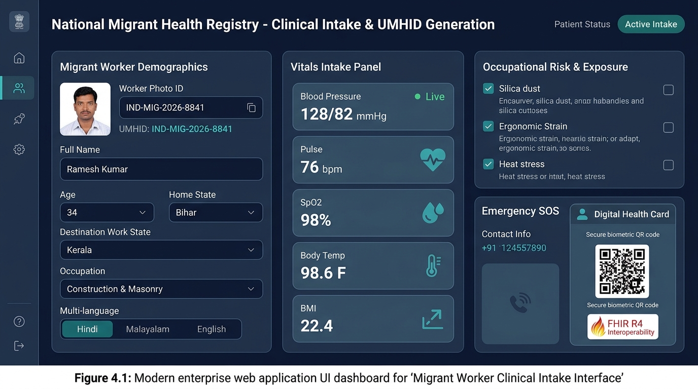
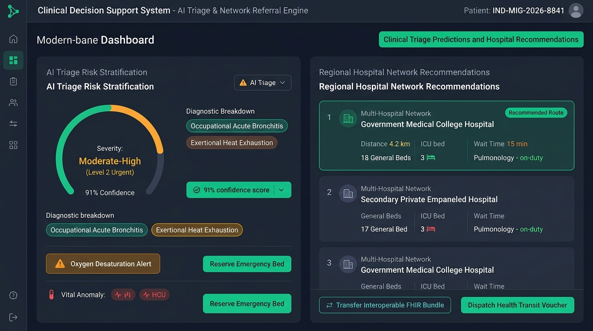
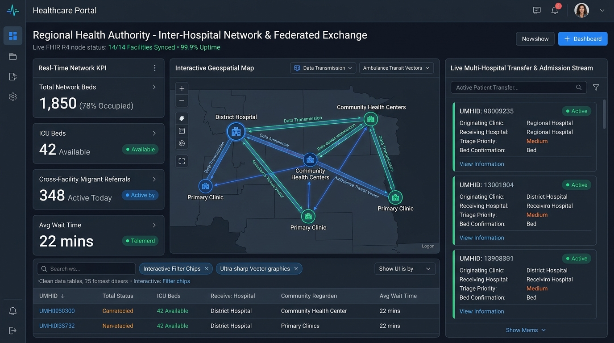
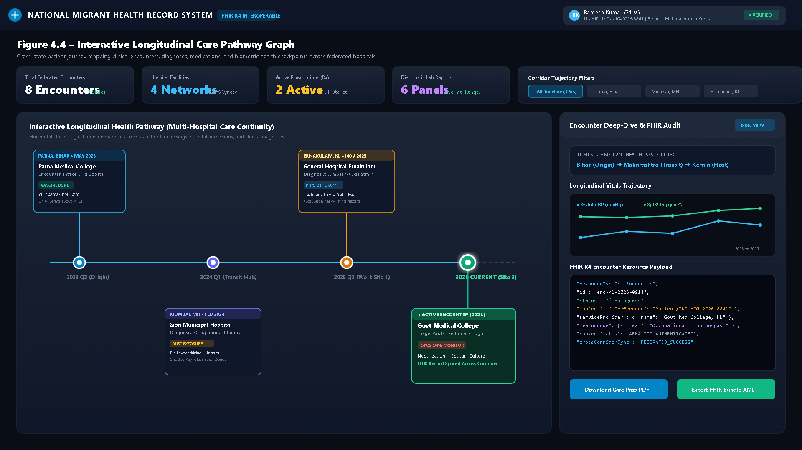
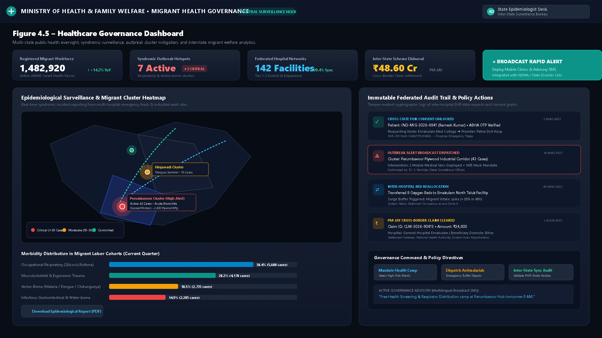
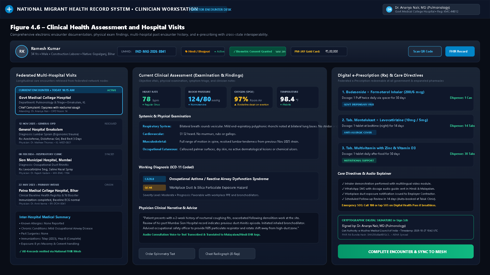

# System Dashboard Figures

**Project:** A SCALABLE CLOUD-BASED INTEROPERABLE DIGITAL HEALTH RECORD, APPOINTMENT MANAGEMENT, AND HEALTHCARE GOVERNANCE PLATFORM FOR MIGRANT WORKERS ACROSS MULTI-HOSPITAL NETWORKS

---

### Interactive Web Viewer
Open the standalone viewer in any browser:
- [dashboard_figures_viewer.html](./figures/dashboard_figures_viewer.html)

---

## Figure 4.1 – Migrant Worker Clinical Intake Interface

- **File Path:** [./figures/Figure_4.1_Migrant_Worker_Clinical_Intake_Interface.jpg](./figures/Figure_4.1_Migrant_Worker_Clinical_Intake_Interface.jpg)
- **Summary:** Multilingual worker intake, UMHID issuance (`IND-MIG-2026-8841`), vital telemetry capture, occupational risk profiling (silica dust, heat stress), and verifiable FHIR R4 QR health card pass.

---

## Figure 4.2 – Clinical Triage Predictions and Hospital Recommendations

- **File Path:** [./figures/Figure_4.2_Clinical_Triage_Predictions_and_Hospital_Recommendations.jpg](./figures/Figure_4.2_Clinical_Triage_Predictions_and_Hospital_Recommendations.jpg)
- **Summary:** AI clinical decision support system, triage urgency gauge (Level 2 Urgent, 91% confidence), diagnostic breakdown, dynamic hospital network routing with live ICU/General bed availability, and instant referral reservation.

---

## Figure 4.3 – Healthcare Portal and Regional Hospital Network

- **File Path:** [./figures/Figure_4.3_Healthcare_Portal_and_Regional_Hospital_Network.jpg](./figures/Figure_4.3_Healthcare_Portal_and_Regional_Hospital_Network.jpg)
- **Summary:** Regional network topology map (14/14 synced facilities, 99.9% uptime), regional capacity telemetry (1,850 network beds), real-time patient transit vectors, and inter-hospital admission stream.

---

## Figure 4.4 – Interactive Longitudinal Care Pathway Graph

- **File Path:** [./figures/Figure_4.4_Interactive_Longitudinal_Care_Pathway_Graph.png](./figures/Figure_4.4_Interactive_Longitudinal_Care_Pathway_Graph.png)
- **Summary:** Chronological care pathway across 2023–2026 (Patna PHC ➔ Mumbai Clinic ➔ Ernakulam Hospital), multi-year biometric trajectories (BP & SpO2 trends), milestone encounter cards, and FHIR R4 JSON inspection pane.

---

## Figure 4.5 – Healthcare Governance Dashboard

- **File Path:** [./figures/Figure_4.5_Healthcare_Governance_Dashboard.png](./figures/Figure_4.5_Healthcare_Governance_Dashboard.png)
- **Summary:** Public health oversight for 1.48M+ registered workers, syndromic outbreak heatmap with industrial cluster alerts, morbidity cohort bars, and immutable SHA-256 audit logs.

---

## Figure 4.6 – Clinical Health Assessment and Hospital Visits

- **File Path:** [./figures/Figure_4.6_Clinical_Health_Assessment_and_Hospital_Visits.png](./figures/Figure_4.6_Clinical_Health_Assessment_and_Hospital_Visits.png)
- **Summary:** Clinician workstation with biometric consent status, multi-hospital past encounter cards, objective physical examination notes, ICD-11 coding, e-prescribing with government dispensary links, and cryptographic digital signatures.
